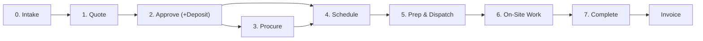

# DispatchBox Workflow: Quote → Approve → Procure → Schedule → Dispatch → Complete

> Written from the code as it is today (Oct 2026). For each stage you get: **who** does it, **where** in the app,
> **required** vs **optional** steps, what the **system does automatically**, and **⚠ friction / gaps**.
> Section 8 lists verified bugs/gaps. Section 9 lists ideas for simplifying.

---

## The Big Picture

### Status cheat-sheet (what each record shows at each stage)

| Stage | Quote status | Job status | Other records |
|---|---|---|---|
| Intake | — | `pending` | Portal ticket `PENDING → CONVERTED` |
| Quote | `draft → sent → viewed` (`tech_review` if customer asks for changes) | `quote_pending` | — |
| Approve | `approved` / `declined` / `expired` / `superseded` | `pending` (again) | Deposit via Stripe |
| Procure | `approved` | `pending` or `scheduled` | PO `draft → sent → received`; job `parts_procurement_status` |
| Schedule | `approved` | `scheduled` | — |
| Prep / Dispatch | `approved` | `scheduled → en_route` | Prep package `not_prepped → prepping → ready → loaded → dispatched` |
| On-site | `approved` | `in_progress` | Scope amendments, field quotes, parts requests |
| Complete | `approved` (not updated) | `completed` | Draft invoice created |

---

## 0. Intake (how the request gets in)

**Who:** Customer, office, AI phone agent
**Where:** Customer Portal, Email Inbox, AI Phone Agent, SMS, Create Job, Job Intake Dashboard

| | Steps |
|---|---|
| **Required** | Capture customer name, contact info, address, and a description of the problem |
| **Optional** | Photos/videos, availability windows, preferred contact method, link to a customer asset, priority |
| **Automatic** | Portal tickets can auto-create a job **and** an AI draft quote. The AI scope check flags requests that fall outside your listed services (`scopeReview: needs_review`) |

⚠ **Friction**
- There are five ways in (portal, email, phone, SMS, manual) and each lands slightly differently: a portal ticket, a job, or a job plus a quote.
- The intake review statuses (`new / in_review / needs_info / approved / rejected`) are separate from job status. It's unclear whether anyone has to act on them.

---

## 1. Quote

**Who:** Office or tech
**Where:** Create Quote / inline AI quote panel, Quotes List, Quote View

| | Steps |
|---|---|
| **Required** | 1. Pick the customer/job → 2. Write the scope of work → 3. Add line items (labor / material / equipment / travel / fee) → 4. Review the total → 5. **Send** (email / SMS / call) |
| **Optional** | AI-generated quote · presentation mode (detailed / category rollup / single price) · discount + reason · tax display · optional line items · material markup · alternate vendors · **"Queue for PO"** on equipment (lets you buy before approval) · deposit (or waive it explicitly) · overrun protection % (default 15%) · valid-until date · estimated duration · terms version / jurisdiction |
| **Automatic** | When the quote is sent, the org's upfront payment policy can **auto-add a deposit** unless you waived it. Delivery is logged. Opening the link sets `viewed`. If the customer requests changes, the status becomes `tech_review` and **AI drafts a revision** for you to review |

⚠ **Friction**
- The quote screen has a lot of optional controls. Most jobs probably need only scope, line items, and send. Consider a "simple / advanced" toggle.
- The deposit can come from three places (manual entry, waive checkbox, auto-policy on send). The tech may not know which one wins.
- You have to set the estimated duration here or the scheduler guesses. It isn't obvious that this field drives scheduling.

---

## 2. Approve

**Who:** Customer (or staff on their behalf)
**Where:** Public quote link / Customer Portal, Deposit Payment page

| | Steps |
|---|---|
| **Required** | Customer reviews → types their name + **signs** → accepts terms → clicks Approve |
| **Optional** | Agree to overrun protection · choose a scheduling preference (email / phone / text) · pick availability windows · **pay the deposit** (required only if the quote requires one) · decline with a reason · request changes |
| **Automatic** | Quote → `approved`. Owner gets a "Quote Approved" email. Job → `pending`. **Auto-schedule runs** (see the gaps below). A callback is queued. A standalone quote approved by logged-in staff auto-creates the job and copies materials/equipment onto it |

⚠ **Friction / gaps**
- **What happens depends on who clicks Approve.** A customer clicking an email link (not logged in) goes through the server path. Staff who are logged in go through the browser path. The two paths behave differently (see 8.3 and 8.6).
- If a deposit is required, auto-schedule stops with "Deposit required". **Paying the deposit later does not restart scheduling** (8.5).

---

## 3. Procure (parts & equipment)

**Who:** Office / purchasing
**Where:** Purchase Orders (backlog) → Master Order Review → Purchase Order Detail → Receiving

| | Steps |
|---|---|
| **Required** *(only if the job needs parts you don't stock)* | 1. Open the PO backlog (it pulls materials from **approved** quotes plus equipment marked "Queue for PO") → 2. Build a master order (grouped by vendor) → 3. Review and send the vendor POs → 4. **Mark received** when the parts arrive |
| **Optional** | Choose a sourcing strategy · swap vendors · enter expected arrival date, carrier, tracking # · receive partially in Receiving · tech-raised parts requests from the field (Field Action Items) |
| **Automatic** | Marking a PO received (or delivered) sets the linked job to `parts_ready = true` and adds the items to inventory. A material stock trigger can unblock jobs that were waiting on stock |

⚠ **Friction / gaps**
- Nothing **requires** procurement before scheduling. A job can be scheduled (even auto-scheduled) while its parts haven't been ordered (8.4).
- The backlog's "needed by" date is always blank because of a field-name mismatch, so you can't sort purchasing by job date (8.7).
- Receiving one PO marks the **whole job** parts-ready, even if the receipt was partial or other POs are still open (8.8).
- Parts requests come in through two paths (the backlog, and field requests in the dispatcher's action items). There's no single "what do I need to buy today" list.

---

## 4. Schedule

**Who:** Dispatcher (or the system)
**Where:** Dispatcher Console, Calendar Board, Schedule Board, Kanban, Solo Calendar / Solo Scheduler

| | Steps |
|---|---|
| **Required** | Assign a **tech** + **date/time** → job becomes `scheduled` |
| **Optional** | Use AI / smart scheduler suggestions · route optimization · multi-day jobs · match the customer's availability windows · material-aware override (`allow_all / estimated_availability / in_stock_only`) · confirm the time with the customer |
| **Automatic** | Auto-schedule on approval (looks up to 7 weekdays ahead). If it fails, the job is flagged `autoScheduleFailed` with a reason on the dashboard |

⚠ **Friction**
- **Six scheduling screens.** Pick one main screen per role (e.g. Dispatcher Console for teams, Solo Calendar for solos) and hide or retire the rest.
- No built-in "confirm appointment with customer" step. The customer may never be told the auto-assigned time.
- The server auto-scheduler always books 9 AM, 1 PM, or 5 PM and ignores the job's duration.

---

## 5. Prep & Dispatch

**Who:** Warehouse / tech, then the tech
**Where:** Job Prep (or Parts Prep Dashboard), Tech Dashboard

| | Steps |
|---|---|
| **Required** | Tech taps **Start Transit** (job → `en_route`, customer gets an SMS) → tech taps **Check In** (job → `in_progress`, GPS stamped, customer gets an SMS, work timer starts) |
| **Optional** | Build a prep package (pick materials + tools from bins) → mark ready → loaded → dispatched · staging location · special instructions · pre-job checklist / tech alerts |
| **Automatic** | En-route / arrival SMS · transit time recorded · Google Maps navigation can open automatically |

⚠ **Friction / gaps**
- There's **no "Dispatched" job status**, and the tech never acknowledges the assignment. "Dispatched" exists only on the prep package, which is optional.
- **Customer SMS currently go to a hardcoded phone number** (8.1). This one matters most.
- Two prep screens (Job Prep vs Parts Prep Dashboard) overlap.

---

## 6. On-Site Work

**Who:** Tech
**Where:** On-Site Execution modal

| | Steps |
|---|---|
| **Required** | Do the work |
| **Optional** | Before/during/after photos · checklist · **scope amendment** (customer approves on the device, by SMS, or verbally) · **field quote request** (new work, sent to the office) · **parts request** (sent to the office) · overrun request (if over the protected %) · delay SMS |
| **Automatic** | Field requests show up as **Field Action Items** for the dispatcher |

⚠ **Friction**
- There are three similar-looking ways to handle "the job got bigger": scope amendment, field quote, and overrun request. Techs need a single rule for when to use which. Suggestion: **under the overrun % → amendment; over it → overrun request; brand-new work → field quote.**

---

## 7. Complete

**Who:** Tech
**Where:** Job Completion Wizard

| | Steps |
|---|---|
| **Required** | Confirm the parts used → **customer signature** (or waive it with "customer not on-site") → Complete |
| **Optional** | Verify prep package usage (unused items go back to inventory) · add parts identified on site · customer rating/feedback |
| **Automatic** | Job → `completed`. Inventory is deducted. Prep package closed. **Draft invoice auto-created.** Completion SMS to the customer |

⚠ **Gaps**
- The draft invoice is built from **parts used + tracked labor**, **not from the approved quote** (8.2).
- The quote is never moved to `completed`, so the quote list can't show what's been finished.

---

## 8. Verified Gaps & Bugs (found in code)

| # | Severity | Issue | Where |
|---|---|---|---|
| 8.1 | 🔴 Critical | En-route and delay SMS send to the hardcoded number `8082829726` instead of the customer's phone | [TechDashboard.tsx:233](file:///x:/Antigravity/Projects/field-service-mgmt/frontend/web/src/pages/TechDashboard.tsx#L233), [:266](file:///x:/Antigravity/Projects/field-service-mgmt/frontend/web/src/pages/TechDashboard.tsx#L266) |
| 8.2 | 🔴 High | Auto-invoice ignores the approved quote: no quoted line items, tax = 0, deposit not credited. A flat-rate quote can produce a $0 or wrong invoice | [JobCompletionWizard.tsx:330-433](file:///x:/Antigravity/Projects/field-service-mgmt/frontend/web/src/components/JobCompletionWizard.tsx#L330-L433) |
| 8.3 | 🟠 High | Two different auto-schedulers. Browser version: skill/workload matching, **skips the deposit check**. Server version: first tech with fewer than 5 jobs that day, fixed times, respects the deposit. Which one runs depends on who approved | [quoteService.ts:51](file:///x:/Antigravity/Projects/field-service-mgmt/frontend/web/src/lib/quoteService.ts#L51-L133), [quoteNotifications.ts:905](file:///x:/Antigravity/Projects/field-service-mgmt/firebase/functions/src/email/quoteNotifications.ts#L905-L1017) |
| 8.4 | 🟠 Medium | Neither auto-scheduler checks parts readiness, so jobs get booked before parts are ordered or received | same as above |
| 8.5 | 🟠 Medium | A deposit paid through Stripe doesn't restart scheduling. The job sits at `pending` with `autoScheduleFailed` | [stripe.ts:308-315](file:///x:/Antigravity/Projects/field-service-mgmt/firebase/functions/src/stripe.ts#L308-L315) |
| 8.6 | 🟠 Medium | A customer approving a **standalone** quote (no job yet) through the public link → **no job is created**. Only logged-in staff approval creates the job | [quoteService.ts:295](file:///x:/Antigravity/Projects/field-service-mgmt/frontend/web/src/lib/quoteService.ts#L295), [quoteNotifications.ts:1078](file:///x:/Antigravity/Projects/field-service-mgmt/firebase/functions/src/email/quoteNotifications.ts#L1078) |
| 8.7 | 🟡 Medium | The PO backlog reads `scheduled_start`, but jobs store `scheduled_at`, so "needed by" dates are always empty | [PurchaseOrders.tsx:657](file:///x:/Antigravity/Projects/field-service-mgmt/frontend/web/src/pages/PurchaseOrders.tsx#L657), [:743](file:///x:/Antigravity/Projects/field-service-mgmt/frontend/web/src/pages/PurchaseOrders.tsx#L743) |
| 8.8 | 🟡 Medium | "Mark received" on any PO sets the whole job to `parts_ready`, regardless of partial receipts or other open POs | [PurchaseOrderDetail.tsx:443-451](file:///x:/Antigravity/Projects/field-service-mgmt/frontend/web/src/pages/PurchaseOrderDetail.tsx#L443-L451) |
| 8.9 | 🟡 Low | Job status `pending` means both "new, not quoted" **and** "approved, waiting to be scheduled". `unscheduled` exists but approval doesn't use it (even though the code comment says it does). `parts_procurement_status` gets the values `needed` / `not_needed`, which aren't in the type | [types.ts:693](file:///x:/Antigravity/Projects/field-service-mgmt/frontend/web/src/types.ts#L693), [quoteService.ts:200](file:///x:/Antigravity/Projects/field-service-mgmt/frontend/web/src/lib/quoteService.ts#L200) |
| 8.10 | 🟡 Low | The quote never moves to `completed` when the job is completed | JobCompletionWizard |

---

## 9. Where to Simplify

1. **One job status pipeline everyone sees:**
   `New → Quoted → Approved → Ready to Schedule → Scheduled → Dispatched → En Route → On Site → Completed → Invoiced`
   Each status should have exactly **one "Next action" button** on the job.
2. **A "Ready to Schedule" gate:** Approved **+** deposit paid (if required) **+** parts ready (or a material override). Auto-schedule runs only when the gate opens, and it re-checks whenever a deposit is paid or a PO is received.
3. **One auto-scheduler on the server.** Delete the browser version.
4. **Invoice = the approved quote + approved amendments/overruns − deposit.** The parts and labor captured at completion become cost tracking, not billing.
5. **Fewer screens:** one scheduling board per role, one prep screen, one "To Buy" list that combines the backlog and field parts requests.
6. **A simple quote mode** with only customer, scope, line items, and send. Everything else goes under "Advanced".
7. **Customer appointment confirmation** after scheduling (SMS/email with the date, time, and tech).
8. **One rule for when the job changes on site** (amendment vs overrun vs field quote, decided by the %).

---

## 10. Decisions for You

- [x] Parts before scheduling → **each business picks** in Workflow Setup (schedule anyway / warn / wait for parts).
- [x] Quote vs T&M → **both, chosen per quote** (or locked to one in Workflow Setup).
- [x] Separate **Dispatched** status → **yes**; tech Accept is optional per business.
- [x] Prep package → **optional**, turned on by the business in Workflow Setup.
- [x] Scheduling screen → the **Dispatcher Console**.

---

## 11. Sandbox Status (staging, 2026-10-27)

Everything below is on **staging only** (dispatch-box-sb.web.app). Nothing has been deployed to production.

| Test | Result |
|---|---|
| Workflow Setup saves, reloads, controls the Prep nav | ✅ |
| T&M quote → customer sees rates + "Estimated Total" → approval creates an `unscheduled` T&M job | ✅ |
| Fixed quote → Save & Send (email + SMS) → customer approves → `unscheduled` fixed job, parts warning | ✅ |
| Dispatcher: Dispatch → amber "waiting" → Undo → re-dispatch | ✅ |
| Tech sees dispatched job → Acknowledge → Start driving → En Route | ✅ (after fix 11.1) |
| T&M invoice: 96 min × $100 + $75 trip + part $22.65 + 25% = **$263.31** | ✅ (after fix 11.2) |
| Fixed invoice: $400 + $50 + 4.712% tax on the taxable part = **$452.36** | ✅ |

**Fixed during testing (2026-10-27):**
- 11.1 Techs didn't see jobs assigned from the Dispatcher Console. My Schedule only matched on email, and the console saves only the tech ID. Now it matches either. Job History had the same problem and is fixed too.
- 11.2 T&M invoices billed $0 labor when completed from the Job page, because no end time was recorded. The wizard now records the end time and minutes on site.
- 11.3 The invoice page showed only the Total, with no Subtotal or Tax rows. Editing a draft also dropped the tax. Both are fixed.
- 11.4 The customer's date-availability check failed because a database index was missing. It now also counts dispatched, en-route and in-progress jobs.
- 11.5 The customer's preferred dates weren't saved on jobs created by approval (they were stored under the wrong field name).
- 11.6 Adding a technician signed the dispatcher out. The new account is now created in a separate background session.
- 11.7 Completing from the tech's My Schedule ("Finish & Complete") now creates the draft invoice. It uses the same builder as the Job page wizard.
- 11.8 Preferred dates are now required at quote approval (at least 2 options, Morning 8–12 or Afternoon 12–5). The page says the office will confirm.
- 11.9 Appointment confirmation: auto-scheduled times are now **proposals**. The customer is told nothing until a dispatcher or the tech clicks "Confirm & notify customer". A dispatcher scheduling or moving the job also counts as confirming. Confirmations go out right away, in the business time zone (previously UTC).
- 11.10 Customers get a "Request a different time" link in the confirmation. They send 2–3 new options plus a note, and the request shows on the Dispatcher Console ("Appointment dates") and on the tech card. Moving the job closes the request and sends the new time.
- 11.11 With Job Prep off, the tech card no longer shows the "Staged · Dock verified" ribbon.
- 11.12 Dispatcher CalendarBoard "Parts Pending" and "Parts Staged" badges and the "PARTS PENDING PREPARATION" modal warning are now gated on `workflow.prepEnabled`.
- 11.13 Job Detail fulfillment status updated to "Parts Ready" instead of "Ready on Site / Staged" to avoid confusion when prep workflow is disabled.
- 11.14 InvoiceDetail "Amount Due" in the header now reflects net balance due (e.g. "$150.00 of $200.00 total · $50.00 paid") when deposits or payments exist, with full deposit deduction breakdown in Payment History.
- 11.15 Quote approval strictly requires at least 2 preferred appointment dates. Omitting dates displays an inline red warning with a red ring on the date section, blocks submission, and smoothly scrolls the customer to the date options.

**Re-test (2026-10-27, staging):**

| Test | Result |
|---|---|
| Add technician → dispatcher stays signed in (also after reload) | ✅ |
| Auto-scheduled job shows "need your OK" on the console, and the customer is not notified | ✅ |
| Tech card: no Dock Verified ribbon (prep off); "Date not confirmed" → Confirm → customer emailed "Wednesday, Oct 28, 10:00 AM HST" | ✅ |
| Customer link shows the confirmed appointment → request Fri/Sat + note → "We got your request" | ✅ |
| Dispatcher moves job → request closed → new time "Friday, Oct 30, 9:00 AM HST" queued to customer | ✅ |
| Tech "Finish & Complete" on My Schedule → job completed + draft invoice ($65 T&M) | ✅ |
| Job page wizard completion → draft invoice | ✅ |
| Quote approval without dates → blocked with alert + inline red warning and ring | ✅ |
| Quote approval with 2 dates → customer approval completes and availability windows saved | ✅ |
| Invoice detail Amount Due with $50 deposit on $200 total → displays "$150.00 of $200.00 total · $50.00 paid" | ✅ |
| Help documentation updated with guide & screenshots at `/help` | ✅ |

